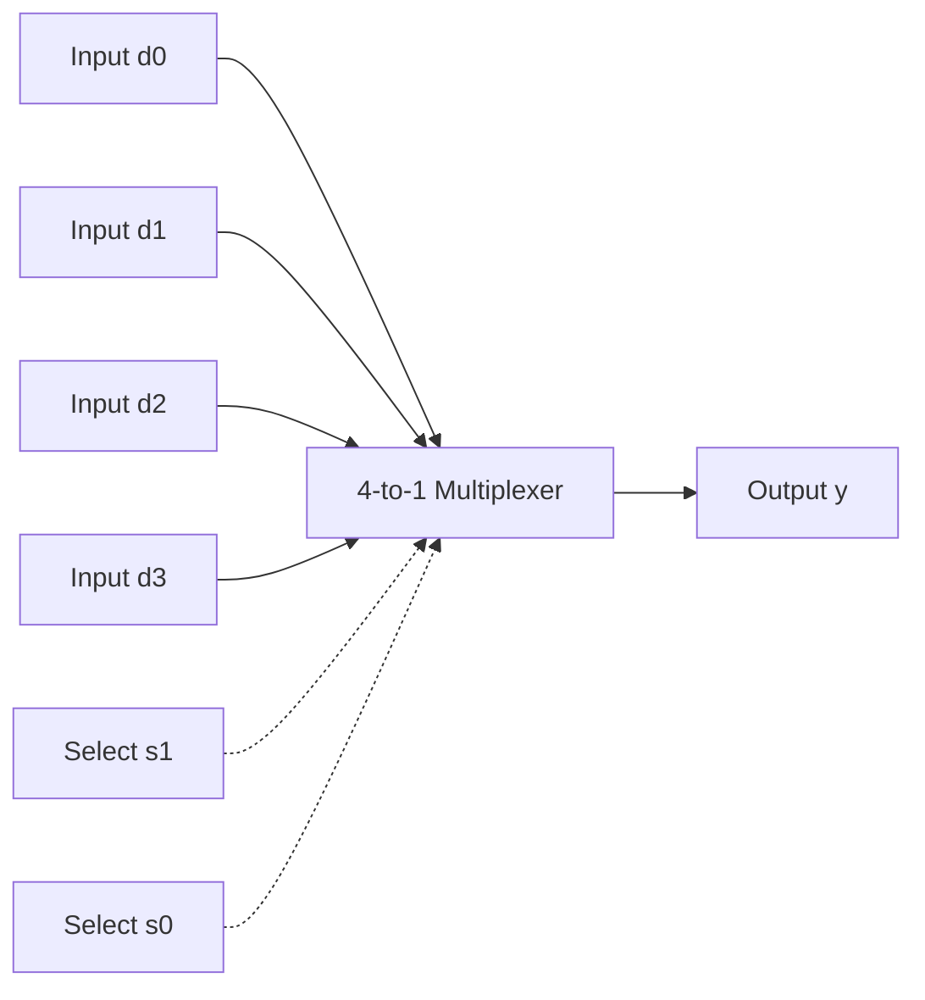

# 4-to-1 Multiplexer in Verilog

### Digital Logic Design | Verilog HDL

A combinational logic circuit that selects one of four binary inputs using two selection bits.

**64 Passed Checks | 0 Failed | Icarus Verilog**

---

## How It Works

The Multiplexer has four data inputs (`d0`, `d1`, `d2`, `d3`), two selection inputs (`s1`, `s0`), and one output (`y`).

The selection bits determine which input is forwarded to the output.

## Logic Diagram



## Selection Table

| s1 | s0 | Output |
|---|---|---|
| 0 | 0 | d0 |
| 0 | 1 | d1 |
| 1 | 0 | d2 |
| 1 | 1 | d3 |

## Project Files

| File | Description |
|---|---|
| `mux4.v` | Multiplexer Verilog design |
| `mux4_tb.v` | Self-checking testbench |
| `README.md` | Project documentation |

## Simulation and Verification

The circuit was tested using Icarus Verilog on EDA Playground.

The testbench checks all 16 data-input combinations against all four selection combinations.

**Verification Results:**

```text
Passed: 64
Failed: 0
ALL 64 MUX CHECKS PASSED
```

### Live Simulation

[View Simulation on EDA Playground](https://www.edaplayground.com/x/iepZ)

## Run Locally

Install Icarus Verilog and run:

```bash
iverilog -g2012 -s mux4_tb -o mux4_test.vvp mux4.v mux4_tb.v
vvp mux4_test.vvp
```

## Technologies

- Verilog HDL
- Digital Logic Design
- Icarus Verilog
- EDA Playground

## Author

**Abdulaziz Al-Modawi Al-Qahtani**

*Digital logic and hardware design project.*
